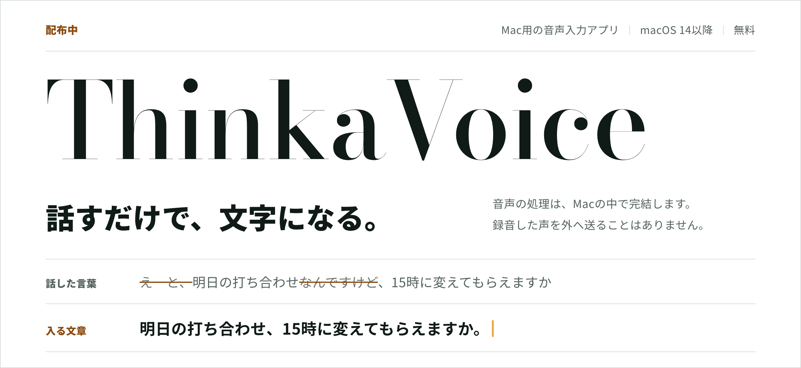
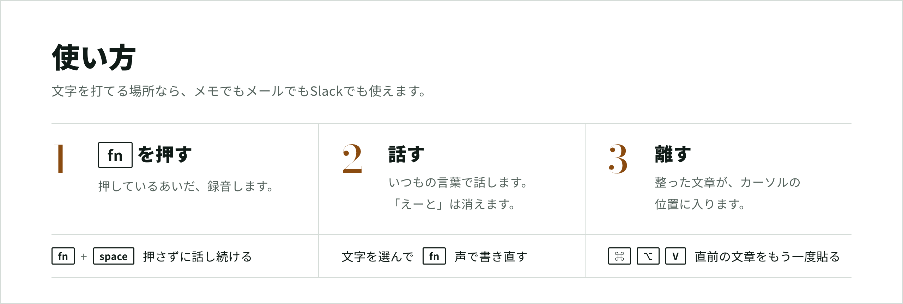
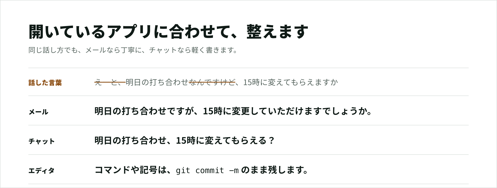

macOS 14以降・Apple Silicon・<a href="https://github.com/syam4869/thinka-voice-releases/releases">リリース一覧</a>・<a href="#english">English</a>

ThinkaVoiceは、話した言葉をそのままカーソルの位置に入力するMac用のアプリです。メモでも、メールでも、Slackでも、文字を打てる場所ならどこでも使えます。

音声の認識も文章の整形も、Macの中で行います。録音した声がサーバーに送られることはありません。

## できること

| 機能 | 内容 |
|---|---|
| 音声入力 | Fnを押して話すと、カーソルの位置に文字が入ります。Fn+Spaceなら、押さずに話し続けられます |
| AI整形 | 「えーと」を消し、句読点と段落を整えます。Apple Intelligenceを使い、Macの中で処理します |
| アプリに合わせた文体 | メールでは丁寧に、チャットでは軽く、エディタでは記号をそのまま残します |
| 声で書き直す | 文字を選んでFnを押し、「敬語にして」「英語にして」と話すと、選んだ部分が書き換わります |
| 辞書と短縮語 | 固有名詞の読みを登録できます。「おつ」を「お疲れ様です」に広げるような短縮語も作れます |
| 15言語 | 日本語と英語のほか、中国語・韓国語・フランス語など15言語に対応します |

## データの扱い

| 対象 | 扱い |
|---|---|
| 音声 | 録音中だけメモリで処理し、保存しません |
| 文字起こしの履歴 | Macの中に最大100件残します。プライバシーモードでは残しません |
| 外部への送信 | 利用状況の計測を含め、外へは送りません |

音声認識はWhisperKitとAppleの音声認識から選べます。WhisperKitならすべてMacの中で完結します。Appleの音声認識を選んだ場合は、macOSの仕組みとしてAppleへ送られることがあります。

## インストール

1. 上のボタンから`ThinkaVoice.dmg`をダウンロードします
2. 開いたウィンドウで、ThinkaVoiceをApplicationsフォルダへドラッグします
3. 起動すると案内が出るので、マイクやアクセシビリティなどの許可を順に出します

AppleのNotarizationを通した署名済みのビルドなので、そのまま開けます。

## 動作環境

- macOS 14 Sonoma以降、Apple Silicon搭載のMac
- AI整形を使うには、Apple Intelligenceに対応したmacOS 26 Tahoe以降が必要です。それ以前のmacOSでは、句読点と辞書による整形だけが動きます

音声入力、AI整形、声で書き直す機能は無料で使えます。アカウント登録もいりません。

 

---

### English

**ThinkaVoice** is on-device AI dictation for Mac. Hold <kbd>fn</kbd>, speak, release — clean text lands at your cursor, in any app.

- Speech recognition and AI formatting run entirely on your Mac with Apple Intelligence and WhisperKit. Your voice never leaves the device.
- Formatting adapts to the app you're in: polite for email, casual for chat, symbols kept intact in code editors.
- Select text, hold <kbd>fn</kbd> and say "make this more formal" or "translate to English" to rewrite it by voice.
- 15 languages, custom dictionary and snippets, Japanese and English UI.

**Requirements:** Apple Silicon Mac, macOS 14+. AI formatting needs Apple Intelligence (macOS 26+). Free to use, no account required.

[Download the latest DMG](https://github.com/syam4869/thinka-voice-releases/releases/latest/download/ThinkaVoice.dmg)

---

## つくった会社

ThinkaVoiceは[Thinka](https://thinka.tech)が企画してつくり、配布しています。Thinkaは、アプリとWebサービスの開発を受けている会社です。

このリポジトリは署名済みのビルドを配るためのものです。アプリのソースコードは公開していません。
